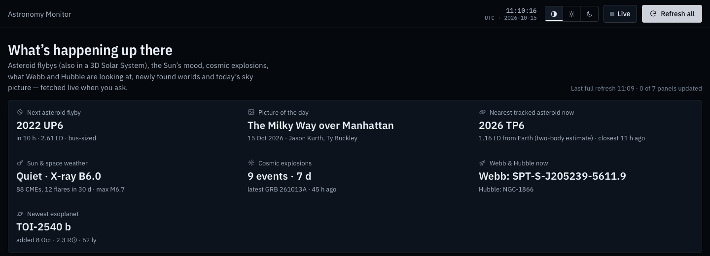
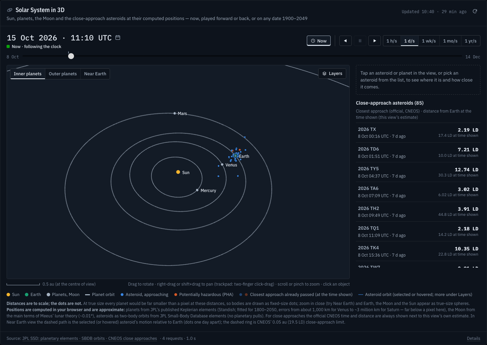
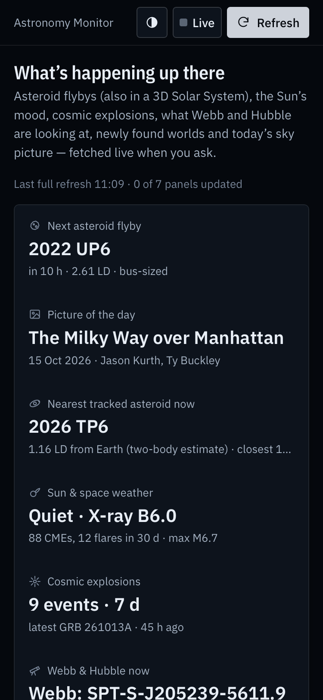

# Astronomy Monitor

A one-page dashboard of what is happening in the sky right now: asteroid flybys, the Sun's activity, cosmic explosions, what Webb and Hubble are observing, newly confirmed exoplanets, NASA's picture of the day, and a 3D Solar System you can scrub through time. Everything comes live from public NASA, NOAA, JPL and STScI data, through one Cloudflare Worker on the free plan.

**Live:** https://astronomy-monitor.almefty.workers.dev

<picture>
  <source media="(prefers-color-scheme: light)" srcset="docs/screenshots/dashboard-light.png">
  <source media="(prefers-color-scheme: dark)" srcset="docs/screenshots/dashboard-dark.png">
  
</picture>

<picture>
  <source media="(prefers-color-scheme: light)" srcset="docs/screenshots/solar-system-3d-light.png">
  <source media="(prefers-color-scheme: dark)" srcset="docs/screenshots/solar-system-3d-dark.png">
  
</picture>

<picture>
  <source media="(prefers-color-scheme: light)" srcset="docs/screenshots/phone-light.png">
  <source media="(prefers-color-scheme: dark)" srcset="docs/screenshots/phone-dark.png">
  
</picture>

## What it shows

| Panel | What you see | Source |
|---|---|---|
| **Asteroid close approaches** | Every near-Earth object passing within 0.05 au (19.5 lunar distances) from a week ago to two months ahead, plotted by time and distance, sized by estimated diameter, hazardous objects flagged | JPL SSD/CNEOS Close Approach Data API |
| **Solar activity & space weather** | A real-time GOES X-ray flux chart (1-minute data, last 6 or 24 hours, current flare class), plus flares (X-ray class), CMEs (speed, direction) and geomagnetic storms (Kp) on one timeline, WSA-ENLIL predicted CME arrivals at Earth, and a top-down map of CMEs travelling through the inner Solar System | NOAA SWPC (GOES) · NASA DONKI (hosted by CCMC) |
| **Cosmic explosions** | Gamma-ray bursts, gravitational-wave candidates and high-energy neutrinos from the last 3/7/14 days of NASA GCN Circulars, on an all-sky map with their error regions, plus an in-page reader for every circular | NASA GCN Circulars archive |
| **Space telescopes** | What Webb and Hubble are observing right now and next, their targets for the coming days on an all-sky map (with the zone Webb can point at today), and the schedule as a timeline | STScI published schedules · MAST · CDS Sesame |
| **Exoplanet discoveries** | All ~6,400 confirmed planets in "discovery space" (orbit vs size), their host stars on an all-sky map, discoveries per year, and cards for the newest additions | NASA Exoplanet Archive (TAP) |
| **Astronomy Picture of the Day** | Today's picture or video with explanation and credit, plus the last week as a filmstrip | NASA APOD |
| **Solar System in 3D** | The Sun, planets, the Moon and every asteroid from the close-approach panel at their computed positions, in a 3D view you can rotate, pan and zoom (touch too). Play time forward or backward at 1 hour to 1 year per second, or jump to any date 1900–2049 or to an asteroid's closest approach. "Near Earth" follows Earth and shows the Moon's orbit and the selected asteroid's path relative to Earth. Each asteroid's official close approach is shown next to this view's own estimate | JPL planetary elements (Table 1) · JPL SBDB orbits · CNEOS Close Approach Data |

Data is fetched **when you press a button**: "Refresh all" at the top, or a panel's own ↻ button. Your last results are kept in your browser so the page isn't empty when you come back. Each panel loads independently, so if one source is down, the rest still work.

**Live mode** (the **Live** switch) is the one exception. While it is on *and the page is visible*, the fast-changing sources refresh themselves: X-ray flux every minute, DONKI solar events every 15 minutes, GCN Circulars every 10 minutes. It is off every time you open the page, pauses whenever the tab is hidden or offline (a hidden tab makes no requests at all), and backs off when a source fails.

## Data sources and credits

All data is fetched from the public services below. None of it is redistributed in this repository, except small saved samples used as test fixtures (`test/fixtures/`) and as a clearly labelled development-only preview. Thanks to the teams who publish it openly.

| Source | Used for | Operated by |
|---|---|---|
| [CNEOS Close Approach Data API](https://ssd-api.jpl.nasa.gov/doc/cad.html) | Asteroid close approaches | NASA/JPL Center for Near-Earth Object Studies |
| [SBDB Query API](https://ssd-api.jpl.nasa.gov/doc/sbdb_query.html) | Asteroid orbits for the 3D view | NASA/JPL Solar System Dynamics |
| [Approximate Positions of the Planets](https://ssd.jpl.nasa.gov/planets/approx_pos.html) (E. M. Standish) | Planet positions (built into the code) | NASA/JPL Solar System Dynamics |
| [DONKI](https://ccmc.gsfc.nasa.gov/tools/DONKI/) | Flares, CMEs, geomagnetic storms, WSA-ENLIL arrivals | NASA Community Coordinated Modeling Center (CCMC) |
| [SWPC GOES X-ray data](https://www.swpc.noaa.gov/products/goes-x-ray-flux) | Real-time X-ray flux and flare list | NOAA Space Weather Prediction Center |
| [GCN Circulars](https://gcn.nasa.gov/circulars) | Cosmic explosions and the circular reader | NASA General Coordinates Network. Circulars are written by the observers who submit them |
| [JWST](https://www.stsci.edu/jwst/science-execution/observing-schedules) and [HST](https://www.stsci.edu/ftp/observing/weekly_timeline/) observing schedules | Webb and Hubble schedules | Space Telescope Science Institute (STScI) |
| [MAST](https://mast.stsci.edu/) | Target positions | Mikulski Archive for Space Telescopes, STScI |
| [Sesame name resolver](https://cds.unistra.fr/cgi-bin/Sesame) | Target positions from catalog names | CDS, Strasbourg Astronomical Observatory, France |
| [NASA Exoplanet Archive](https://exoplanetarchive.ipac.caltech.edu/) | Exoplanets | Caltech/IPAC under contract with NASA (Exoplanet Exploration Program) |
| [Astronomy Picture of the Day](https://apod.nasa.gov/apod/astropix.html) | Picture of the day | Robert Nemiroff and Jerry Bonnell, hosted by NASA |

**APOD images and videos belong to their credited authors**, and many are copyrighted. The dashboard shows them as NASA publishes them, always with the credit and copyright line, and links back to the entry. The page's own fonts are IBM Plex (SIL Open Font License), bundled via Fontsource. "View sky in Aladin" links open CDS's Aladin Lite.

This dashboard is an independent project. It is not affiliated with or endorsed by NASA, NOAA, JPL, STScI, CDS or Caltech/IPAC.

## Run it locally

You need [Node.js](https://nodejs.org/) 22.12 or newer (developed on Node 26) and Git.

```bash
git clone https://github.com/Almefty/astronomy-monitor.git
```

```bash
cd astronomy-monitor
```

```bash
npm install
```

```bash
npm run dev
```

Open **http://localhost:5173** and press **Refresh all**. `npm run dev` starts Vite together with the Worker in Cloudflare's local runtime (workerd), so `/api/*` behaves as in production.

### NASA API key (optional)

The Worker reads an optional `NASA_API_KEY`. Without one it falls back to NASA's shared **`DEMO_KEY`** and the page shows a small "Using NASA's public DEMO_KEY" notice. Today the key only matters for APOD's last-resort fallback (`api.nasa.gov`); the main sources need no key. A free key is available at [api.nasa.gov](https://api.nasa.gov/).

For local development, copy `.dev.vars.example` to `.dev.vars` (it is gitignored) and put the key after `NASA_API_KEY=`. Then restart `npm run dev`. The key is only read by the Worker. It is never sent to the browser, and it is redacted (`api_key=***`) from the request log each panel shows under "Details".

## Deploy it on Cloudflare (free plan)

The app is one Worker with static assets. It needs no database, no KV/R2/D1, no cron triggers and no paid features. The free plan's limits (100,000 requests/day, 10 ms CPU per request, 50 subrequests per request) are respected by design; see [How it's built](#how-its-built).

**From the dashboard (auto-deploys on every push):**

1. Fork this repository on GitHub.
2. In the [Cloudflare dashboard](https://dash.cloudflare.com/), open **Workers & Pages → Create → Import a repository**, connect GitHub and pick your fork.
3. Keep the project name `astronomy-monitor` (it must match `name` in `wrangler.jsonc`). Set **Build command** to `npm run build` and **Deploy command** to `npx wrangler deploy`.
4. After the first deploy, open the Worker's **Settings → Variables and Secrets**, add a **Secret** named `NASA_API_KEY` with your key, and deploy again. Skip this to use `DEMO_KEY`.

**From the command line:**

```bash
npx wrangler login
```

```bash
npm run deploy
```

```bash
npx wrangler secret put NASA_API_KEY
```

Your site is then live at `https://astronomy-monitor.<your-subdomain>.workers.dev`. Build logs are under **Workers & Pages → astronomy-monitor → Deployments**. The rate-limit binding's `namespace_id` in `wrangler.jsonc` is just a number unique within your account; it needs no setup.

## Privacy

- **No analytics, no tracking, no cookies, no accounts.** The page loads no third-party scripts. Fonts are self-hosted, and the Content-Security-Policy (`public/_headers`) only allows the page to call its own `/api`.
- **Stored in your browser (`localStorage`, prefix `astronomy-monitor:v1:`):** your theme choice, and the last result of each panel, so the page isn't empty on your next visit. Nothing else is saved; Live mode and the 3D view's time and camera reset on every visit. Nothing in storage is sent anywhere, and clearing site data removes it.
- **Requests:** data requests go to this site's own Worker, which calls NASA/NOAA/JPL/STScI/CDS on your behalf, so those services don't see your IP address. The Worker uses your IP address only for a short-lived per-client rate limit, and doesn't store or log it. Cloudflare, as the host, processes requests under its own [privacy policy](https://www.cloudflare.com/privacypolicy/), and Workers Logs (enabled in `wrangler.jsonc`) keep request metadata for a few days.
- **Loaded straight from third parties:** APOD images come directly from NASA's servers, and an APOD video plays in a sandboxed YouTube (`youtube-nocookie.com`) or Vimeo player. Those services see your IP address when that content loads. "View in Aladin" and other outbound links open the external site in a new tab.

## Commands

| Command | What it does |
|---|---|
| `npm run dev` | Start the local dashboard at http://localhost:5173 |
| `npm test` | Run the unit tests |
| `npm run typecheck` | Type-check browser and Worker code |
| `npm run build` | Production build into `dist/` |
| `npm run check` | All three of the above |
| `npm run deploy` | Build and deploy with Wrangler |

## How it's built

```
worker/                 Cloudflare Worker = the only server code (holds the secret, calls upstream APIs)
  index.ts              front door for /api/*: rate limit, canonical URL → cached `Api` entrypoint
  api.ts                routes: /api/status, /api/sources/:id, /api/exoplanets/catalog, /api/gcn/circulars/:id;
                        Cache-Control per response
  lib/params.ts         declared query parameters per source (values clamped; also the cache key)
  lib/ratelimit.ts      per-client limit (IPv4 address / IPv6 /64), fails open
  lib/upstream.ts       fetch with timeouts, typed errors, API-key redaction, call log shown in the UI
  lib/coords.ts         strict sky-coordinate parsing from circular text and from target names
  sources/*.ts          one module per data source → normalized JSON (see shared/contract.ts)
                        (v2: gcn.ts, telescopes.ts, goes.ts; v3: orbits.ts)
shared/contract.ts      the JSON contract between Worker and browser
shared/astro.ts         time, Sun position, angular separation, small circles (Worker + browser)
shared/orbit.ts         v3: Kepler solver, JPL planetary elements, Moon, Earth, closest approach (browser + tests)
src/                    browser app (TypeScript + D3 scales, no framework)
  core/panel.ts         panel framework: loading, errors, snapshots, per-panel isolation, live feeds, in-place updates
  core/live.ts          live mode: per-feed timers, pauses when hidden/offline, back-off on failures
  core/reader.ts        the GCN Circular reader (dialog)
  panels/*.ts           one module per panel (fetch → render → summary for the "Right now" strip)
  viz/                  shared chart pieces (axes, hover layer, label placement, tooltip, sky projection)
  viz/orrery-model.ts   v3: positions, distances and accuracy checks for the 3D panel (no three.js)
  viz/orrery3d.ts       v3: the three.js scene (lazy chunk; the only file that imports three)
  styles/               design tokens (light + dark) and layout
public/_headers         security headers (Content-Security-Policy etc.) for the deployed site
test/                   unit tests for the Worker normalizers (incl. a real DONKI fixture) and the orbit
                        math against JPL Horizons vectors (test/fixtures/orbits-2026-10-15.json)
```

- **Free-plan friendly:** static files are served from Cloudflare's asset store (free); only `/api/*` runs the Worker. The 0.8 MB exoplanet catalog is streamed through without parsing, which keeps the Worker far under the free plan's 10 ms CPU limit. No database, no cron jobs, no paid services. Version 2 keeps to the same limits: the telescope panel asks for Webb and Hubble in two parallel requests (halves CPU per request; Hubble's ~200 KB timeline is only cut into columns inside the display window), the JWST schedules page is scanned with `indexOf` and abandoned after the first links, a GCN refresh stays under the 50-subrequest limit (≤ 5 list pages + ≤ 40 circulars), and live updates fetch the 6-hour X-ray file (~160 KB) and merge it into the day already shown. With one open tab, live mode costs at most ~1,500 Worker requests per day (free plan: 100,000).
- **Caching and rate limit:** Cloudflare's Workers Cache sits in front of the API. Each response says how long it may be reused — GOES X-rays 60 s, GCN 5 min, DONKI 10 min, APOD 30 min, close approaches, asteroid orbits and telescope schedules 1 h, exoplanets 6 h — always shorter than the live-mode interval for live feeds. A repeated request within that time is answered by Cloudflare without running the Worker or calling NASA/NOAA/STScI. Errors, partial failures and sample data are never cached. The time shown on each panel is when the data was actually fetched. Per client, `/api/*` allows 120 requests a minute (a "Refresh all" is about 10); beyond that the panels keep their data and say "Too many requests". (As of 14 Oct 2026 Cloudflare doesn't enforce this limit on this free workers.dev Worker — a known issue; it works locally and will take effect once fixed.)
- **Content-Security-Policy unchanged:** every upstream call goes through the Worker (`connect-src 'self'`), the sky maps are drawn locally (no external scripts or map tiles), and "View sky in Aladin" is an ordinary link that opens CDS's Aladin Lite in a new tab. Embedding Aladin Lite would have needed its script host, WebAssembly (`'wasm-unsafe-eval'`) and its image-tile servers in the CSP, so it was not embedded.
- **Secret handling:** `NASA_API_KEY` exists only as a Worker secret (Cloudflare) or in `.dev.vars` (local, gitignored). It is never sent to the browser, never logged, and redacted (`api_key=***`) from the request log shown in each panel's "Details".
- **Why `npm run dev` runs `scripts/dev.mjs`:** Cloudflare's local runtime (workerd) doesn't yet trust the certificate chain used by `*.jpl.nasa.gov`, so the launcher hands it Node's bundled Mozilla root certificates. Nothing is installed system-wide; production on Cloudflare doesn't need this.

### Adding a panel

1. **Backend:** add `worker/sources/<name>.ts` implementing `SourceModule`, register it in `worker/sources/index.ts`, and add its types to `shared/contract.ts`.
2. **Frontend:** add `src/panels/<name>.ts` implementing `PanelDefinition` (`load`, `render`, optional `summarize`/`controls`/`live`/`migrate`), and register it in `src/panels/index.ts`.
   - `load(signal, params, prev)` gets the result currently shown, so a partial refresh can keep what it doesn't reload (the solar panel's GOES and DONKI feeds).
   - `render()` may return a view with `update(result)` to apply new data in place (live mode keeps hover, open lists and scroll position).
   - `live: [{ label, everyMs, params }]` opts a panel into live mode; `migrate()` upgrades snapshots saved by an older version.

### 3D Solar System: where things are

- `src/panels/solarsystem.ts` — the panel: time bar (now / play / speed / slider / jump), camera views, asteroid list, details cards, links with the close-approach panel, lazy start of the 3D view, pause when off-screen or hidden, WebGL fallback. View state (time, speed, view, selection) survives a refresh but not a new visit (every visit starts at "now").
- `src/viz/orrery3d.ts` — the three.js scene (on-demand rendering, picking, labels, scale bar). Only this file imports `three`.
- `src/viz/orrery-model.ts` and `shared/orbit.ts` — all numbers, shared by the list, the details, the "Right now" strip and the 3D view.

## Known limitations

- **3D Solar System positions are approximate** (see "Version 3" under Implementation notes): planets to within JPL's stated errors for its approximate elements, asteroids as two-body orbits without planetary pulls. Most close approaches match CNEOS within a few percent; objects with short arcs or old orbits can be far off, and the panel says so per object. For anything precise, use the official CNEOS numbers shown next to the estimate, or JPL Horizons.
- **Bodies in the 3D view are dots, not to scale** (distances are); true-size spheres appear only when zoomed in close.
- **The 3D date range is 1900–2049**, inside the 1800–2050 range JPL fitted its planetary elements for. Asteroid positions far from their orbit's epoch (more than a year) are flagged as rough.
- **On phones, dragging on the 3D view rotates it rather than scrolling the page**; scroll by dragging outside the view (it leaves room above and below).

- **DONKI may be unreachable from your own network.** CCMC refuses connections from some networks, so in local development the solar panel's event catalogue may fail to load (the live X-ray chart above it still works); the deployed site loads both. Locally, use the clearly marked saved sample.
- **GCN positions are machine-read from free text.** The parser is strict and cross-checks positions within an event, but a circular can describe more than one source; the reader is one click away, and the tooltip names the circular a position came from. A refresh reads at most 40 circular texts, so events with only low-priority circulars may show "no position read yet". GW candidates aren't drawn (their localizations are sky maps, not points).
- **Telescope schedules are plans.** Webb runs an event-driven schedule and Hubble's can change after publication, so actual times can differ by hours. STScI publishes the next week's schedule only a few days ahead; until then the timeline says "not yet published". A format change makes that telescope's part say so (by design) until the parser is updated.
- **Some telescope targets have no position**: Solar System targets (they move), and fixed targets that are neither in MAST nor resolvable by name. Positions taken from coarse names (e.g. `J2150-4652`) are marked "approx." (good to about a degree).
- **Live mode is only as live as the sources:** SWPC's 1-minute X-ray data typically appears 1–3 minutes after the measurement.
- CME positions on the "in transit" map assume constant speed; real CMEs speed up or slow down. Earth-arrival times and Kp ranges are WSA-ENLIL model output, not certainties.
- Asteroid sizes are estimated from brightness unless JPL has a measurement (it rarely does for small objects).
- Exoplanet radii for non-transiting planets are often estimated by the archive from mass. That creates the horizontal "stripe" of giant planets near 13 R⊕.
- The Exoplanet Archive is sometimes slow (up to ~25 s). If its count query times out, the total is counted from the catalog instead.
- The DEMO_KEY allows only a handful of requests per hour, which matters only if the APOD fallback is used.
- **Cached data can be up to one lifetime old** (e.g. 60 s for X-rays, 5 min for GCN); "Refresh" within that window returns the same data.
- **APOD images belong to their credited authors** (many are copyrighted). The dashboard shows them as NASA publishes them, with the credit, and doesn't relicense them.

---

# Implementation notes

How each source was verified against its live API, and the quirks found along the way. Dates are when each check was made.


## Version 3: the 3D Solar System (verified against the live services, 15 Oct 2026)

**Data.** Planets need no request: their orbits come from JPL's published *Approximate Positions of the Planets*, Table 1 (Standish; `ssd.jpl.nasa.gov/planets/approx_pos.html`, checked against the live page), built into the code. The Worker's new endpoint `/api/sources/orbits` returns the same close approaches as the asteroid panel (CNEOS CAD API) plus each object's osculating orbit from the **JPL SBDB Query API** (`ssd-api.jpl.nasa.gov/sbdb_query.api`, full precision, PHA flag included). Three quirks found while verifying it: the API rejects spaces in `EQ` filters (despite its docs), so designations are matched with anchored regexes (`pdes|RE|^2026 TX$`); it answers 502 once the filter passes ~1,000 characters, so ~30 designations go in each request and the requests run in parallel; and `sb-group=neo` cuts each query from ~15 s to ~1 s. A refresh is 1 CAD call + 3–4 SBDB calls, cached for 1 hour like the close approaches.

**Math, in the browser** (`shared/orbit.ts`): Kepler's equation (elliptic, hyperbolic and parabolic), planet positions from Table 1, Earth = Earth–Moon barycentre minus the Moon's share, the Moon from the main terms of Meeus' lunar theory, and a closest-approach search. Positions are recomputed every frame while time plays; nothing is fetched when you move the time.

**Accuracy (checked against JPL Horizons, DE441, in `test/orbit.test.ts`):**

| Body | Method | Error found (Oct 2026 / Jan 2027 / Jan 2010) |
|---|---|---|
| Mercury, Venus, Earth, Mars | JPL Table 1 | 1,000–27,000 km (≤ 23″) — within JPL's stated errors |
| Jupiter … Neptune | JPL Table 1 | 0.5–3 million km (≤ 450″, Saturn worst) — within JPL's stated errors; well under a pixel at Solar System scale |
| Moon (from Earth) | Meeus, main terms | 16–58 km (≤ 0.01°) |
| Close-approach asteroids | two-body orbit from SBDB elements | closest-approach distance within 2 % of CNEOS' official value for 90 % of the 83 objects of 15 Oct 2026 (median 0 %), time within a few hours |

The exceptions are objects with poorly known or old orbits: 2022 UP6 (a 1-day arc from 2022) comes out at 0.47 LD instead of CNEOS' 2.61 LD. That's why the panel always shows **CNEOS' official time and distance next to its own estimate**, tags the agreement (*matches* ≤ 5 % and ≤ 2 h, *close*, or *differs — rough only*), shows the orbit's condition code, data arc and epoch, and warns when the time shown is more than a year from the orbit's epoch.

**Scale.** Distances are true to scale; the bodies are not (at true size every planet would be far smaller than a pixel). Bodies are drawn as fixed-size dots, which turn into true-size spheres when you zoom in far enough (Earth, the Moon, the Sun). A scale bar shows the scale at the centre of the view. The panel says so under the view.

**Performance.** three.js (0.186.1, bundled, 142 KB gzipped) is a separate chunk loaded with `import()` only when the panel scrolls into view, so the rest of the dashboard is unaffected (no CSP change: it is served from `'self'`). The view draws a frame only when something changes (time playing, camera moving, selection, theme), stops completely when it is off-screen or the tab is hidden, caps the pixel ratio at 2, and draws all asteroid orbits in a single draw call. Touch: one finger rotates, two fingers pinch-zoom; tap selects. With *reduce motion* on, camera moves are instant and there is no inertia. Without WebGL 2 the panel says so and keeps the time controls, list and details working.

**Linked with the close-approach panel.** Each "Closest upcoming" entry there has a 3D button that selects the asteroid in the 3D view (Near Earth); the 3D details have "Show in close-approach chart", which scrolls to the chart and highlights the dot with its tooltip.

## Sources added in version 2 (verified against the live services, 13 Oct 2026)

- **NASA GCN Circulars** — read from the public archive at `gcn.nasa.gov/circulars` (no account, no Kafka stream). The archive list (IDs and subjects, newest first, filtered by date) comes from the archive page's own data route, with the page's HTML as a fallback; each circular's text comes from its official JSON export `gcn.nasa.gov/circulars/<id>.json`. Events are grouped by the designation in the subject (GRB 261013A, IceCube-261012A, S251117dq; "GRB 261007A / EP261007a" merges the Einstein Probe name into the GRB). Because the free plan allows 50 upstream requests per request, a refresh reads the texts of up to 40 of the most informative circulars (enhanced Swift-XRT positions, optical afterglows, IceCube's own alerts first). Positions are extracted from that text by a strict parser (decimal and sexagesimal formats, IceCube's ± containment, stated 90% errors); the smallest stated error wins, and only if it agrees with the coarser positions of the same event. No gravitational-wave candidates were circulated in the weeks before 13 Oct 2026 (the newest LIGO/Virgo/KAGRA circulars in the archive date from November 2025), so that category may be empty; when present, GW candidates are listed with their sky-map area and classification and a link to GraceDB, not drawn as points.
- **STScI observing schedules** — Webb: the weekly "report" text files linked from `stsci.edu/jwst/science-execution/observing-schedules`; Hubble: the weekly timelines in `stsci.edu/ftp/observing/weekly_timeline/`. There is no API, so the parser finds the columns from each report's own header and dashed separator line, validates every row (dates, durations, IDs, coverage range) and **rejects the whole report with an explanation if anything doesn't look as expected** — the panel then says "Schedule format not recognised" for that telescope instead of guessing. The current week plus next week (once published) are read.
- **Target positions** — the schedules name targets but have no coordinates. In order: **MAST** (STScI's archive API; Webb's *planned* observations carry the scheduled pointing; for Hubble, earlier observations of the same target in the same program), coordinates **encoded in the target name** (e.g. `J095236+405249`, `2MASS-J04285053+1844361`), and the **CDS Sesame** name resolver for catalog names (`NGC-855` → NGC 855). Every position is then checked against the telescope's Sun-angle limits at the time of the observation (Webb 85–135° from the Sun, Hubble ≥ 50°); impossible ones are dropped. On 13 Oct 2026 this placed 63/63 Webb and 46/48 Hubble sky targets, none rejected. Solar System targets (they move) are listed but not drawn.
- **NOAA SWPC GOES X-rays** — `services.swpc.noaa.gov/json/goes/primary/xrays-1-day.json` (and `xrays-6-hour.json` for live updates), 1-minute data from the primary GOES satellite (GOES-18 in Oct 2026), both channels, plus SWPC's flare list. SWPC caches these for 60 s, which matches live mode's 1-minute cadence. In eclipse season (around the equinoxes) the satellite passes through Earth's shadow once a day and the flux drops to zero for up to ~70 minutes; the chart shows that as a "data gap".

## What changed at NASA (verified 9 Oct 2026)

All four sources were checked against their live APIs before building:

- **JPL Close Approach Data** — works as documented.
- **NASA Exoplanet Archive TAP** — works. "Newly added" uses the earliest `releasedate` of each planet in the `ps` table. Response times vary a lot (1–25 s), so timeouts are generous.
- **DONKI** — on 30 Sep 2026 DONKI moved from `api.nasa.gov/DONKI/*` (which now redirects to a CCMC notice page) to **`https://ccmc.gsfc.nasa.gov/DONKI-API/get/*`**: same parameters and JSON, no API key, max 60-day range. CCMC refuses connections from some networks, **including the one this project was developed on**; it works from Cloudflare's network (tested on Cloudflare's edge). So locally the solar panel shows an explanation plus a *"Preview with saved sample"* button (real DONKI data captured on 9 Oct 2026, clearly labelled, development only). Once deployed it uses live data.
- **APOD** — APOD moved to science.nasa.gov. The old `api.nasa.gov/planetary/apod` now returns placeholder records (title "NASA Science", the NASA logo as image) and is reported to go offline on 1 Dec 2026. The dashboard uses the new official endpoint **`science.nasa.gov/wp-json/wp/v2/apod-basic`**. Two fallbacks: NASA's official APOD RSS feed (`science.nasa.gov/feed/apod-basic/`, same fields), used when the JSON API fails (on 11 Oct 2026 it briefly answered with a JavaScript "Checking your browser" page) or lags behind today's APOD; and `api.nasa.gov`, used only if it returns real records (placeholder records are rejected). The panel notes which source it used and why.


## License

The code is MIT-licensed; see [LICENSE](LICENSE). That license covers only the code and documentation written for this project. **It does not cover NASA/APOD images and videos, or any third-party data** (including the saved samples in `test/fixtures/` and the screenshots in `docs/screenshots/`, which show such data). Those remain under their owners' terms; see [Data sources and credits](#data-sources-and-credits).
